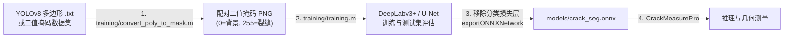

本文档说明如何使用 `training/` 目录下的 MATLAB 脚本，将 YOLOv8 多边形 `.txt` 或二值掩码数据集转换为训练样本，训练语义分割模型（`DeepLabv3+` / `U-Net`）并导出 `crack_seg.onnx`。

---

## 流程概览



---

## 第一步：数据准备与掩码转换

### 1.1 数据集来源

| 数据集名称 | 样本数量 | 标注格式 | 链接 |
| :--- | :--- | :--- | :--- |
| **内置数据集** (`training/dataset/`) | 1,299 张 | YOLOv8 多边形 `.txt` | 仓库内置（CC BY 4.0） |
| **Roboflow Concrete Crack** | 900 ~ 20,000+ 张 | YOLOv8 多边形 `.txt` | [universe.roboflow.com](https://universe.roboflow.com) |
| **Crack500** | 3,368 张 | 二值掩码 `.png` | [GitHub: pavement-crack-detection](https://github.com/fyangneil/pavement-crack-detection) |
| **DeepCrack** | 537 张 | 二值掩码 `.png` | [GitHub: yhlleo/DeepCrack](https://github.com/yhlleo/DeepCrack) |

> 注：经非等比拉伸（Stretch）的数据集仅用于分割特征训练；在 `CrackMeasurePro` 中测量物理尺寸（`mm`）时，需使用未变形相机原图并通过参照物标定 `mm/px`。

### 1.2 执行 `training/convert_poly_to_mask.m`

脚本支持以下两种输入模式，并按序号前缀重命名输出文件，防止同名图像覆盖：

* **`MODE = 'poly_txt'`（默认）**：解析 YOLOv8 多边形顶点 `.txt`（`class_id x1 y1 x2 y2 ... xn yn`），调用 `poly2mask` 生成二值掩码 `.png`（`0` = 背景，`255` = 裂缝），同时兼容 5 列矩形框格式 `[class_id, cx, cy, w, h]`。
* **`MODE = 'mask'`**：将外部掩码数据集（logical、`{0,1}`、`{0,255}` 或 RGB 掩码）转换为单通道 `uint8` `{0, 255}` 的 `.png` 文件。

运行前配置脚本中的输入输出路径：
```matlab
imgDir     = 'dataset/train/images';
annoDir    = 'dataset/train/labels';
outImgDir  = 'dataset_seg/images';
outMaskDir = 'dataset_seg/masks';
```

---

## 第二步：模型训练与 ONNX 导出

### 2.1 MATLAB 依赖工具箱

1. **Computer Vision Toolbox**
2. **Deep Learning Toolbox**
3. **Deep Learning Toolbox Model for ResNet-18 Network**（使用 `deeplabv3plus` 时需要；未安装时脚本自动切换为 `unetLayers`）
4. **Deep Learning Toolbox Converter for ONNX Model Format**
5. **Parallel Computing Toolbox**（GPU 训练需要）

### 2.2 执行 `training/training.m`

脚本处理流程：
1. **网络架构**：默认 `MODEL_TYPE = 'deeplabv3plus'`（ResNet-18 骨干），可选 `'unet'`。
2. **输入归一化**：将 `imageInputLayer` 的 `Normalization` 设为 `'none'`，输入图像通过 `im2single` 映射至 `[0, 1]`，与 `CrackMeasurePro` 推理输入一致。
3. **数据增强**：随机颜色抖动与仿射变换（翻转、$\pm 25^\circ$ 旋转、`0.85~1.15` 缩放）；图像越界像素填充 `128`，标签越界像素填充 `"background"`。
4. **类别加权**：统计训练集背景与裂缝像素占比，按中位数频率比计算类别权重（上限 `15.0`）并写入 `pixelClassificationLayer`。
5. **评估与导出**：按 `80% : 10% : 10%` 划分训练/验证/测试集，输出测试集裂缝类别 `IoU` 与 `MeanBFScore`，移除末尾分类损失层后以 Opset 12 导出 `crack_seg.onnx`。

---

## 第三步：部署模型

将生成的 `crack_seg.onnx` 覆盖至 `models/crack_seg.onnx`（或可执行文件同级目录）。
